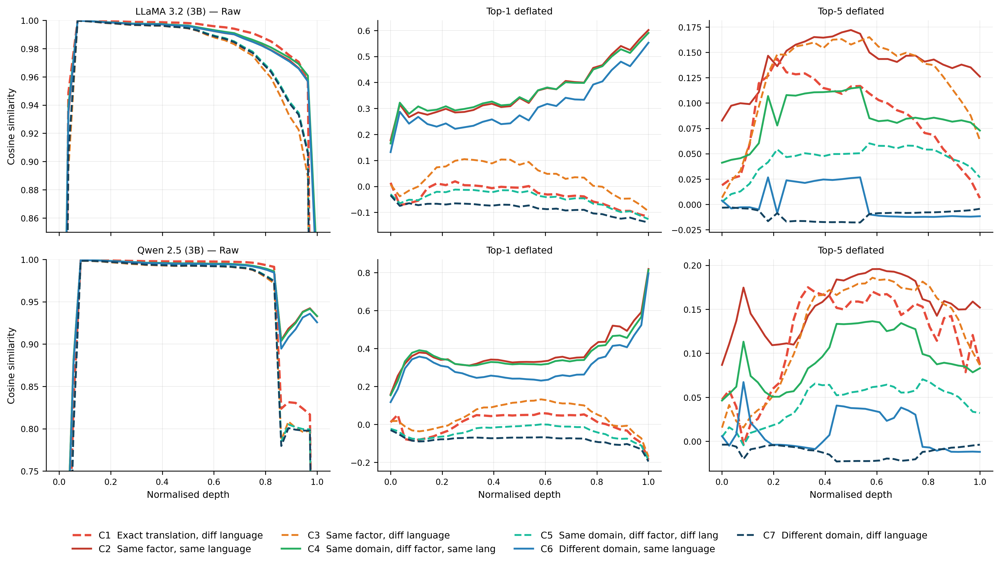
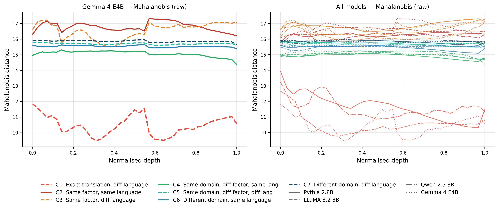
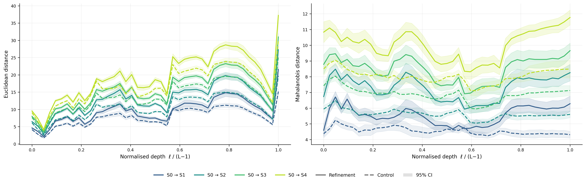
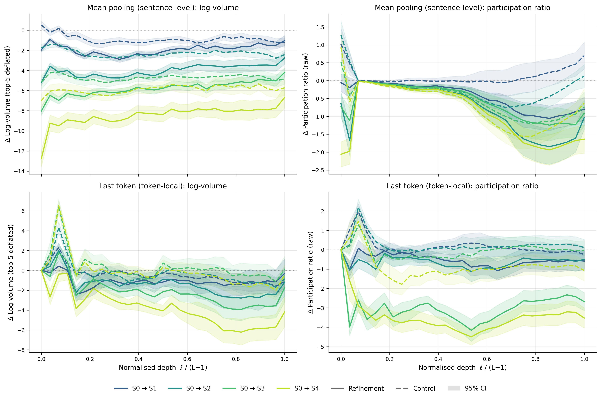

# Meaning Contracts: Local Semantic Geometry in Large Language Models

**Andrés Daniel Godoy Ortiz** · Imperial College London

📄 **[Read the paper (PDF)](Meaning%20Contracts.pdf)** · [Citation](#citation)

Code, probe datasets and the outputs behind every figure and table of the paper.

---

## Overview

Representation analyses usually ask whether two meanings are *close* in embedding
space, or whether a linear probe can *separate* them. This work asks a different
question: what does the **local** geometry around a single meaning look like? That is,
what stays invariant across ways of expressing it, what varies, and what happens when
the meaning is made more specific?

We answer it with two controlled probes, applied to the frozen hidden states of four
architecturally diverse decoder-only LLMs. Everything is training-free.

| Model | Family | Hidden-state stack | Width |
|---|---|---|---|
| Pythia 2.8B | GPT-NeoX style decoder | 33 | 2560 |
| Llama 3.2 3B | Llama-family decoder | 29 | 3072 |
| Qwen 2.5 3B | Qwen-family decoder | 37 | 2048 |
| Gemma 4 E4B | Gemma-family decoder | 43 | 2560 |

<sub>Layer counts include the input embedding state.</sub>

## Key findings

All four findings recur in every model family.

**1. Depth-local semantic order.** In raw hidden states, sentences cluster by language.
Once the dominant high-variance directions are removed (top-*k* PCA deflation), sentence
pairs order by semantic relatedness without overlap over a band of layers: same factor,
then same domain, then different domain. Deflation also improves cross-lingual retrieval
for every language at every depth tested.


<sub>Figure 1: cosine geometry for Llama 3.2 3B (top) and Qwen 2.5 3B (bottom), raw → top-1 → top-5 deflation.</sub>

**2. An invariant core with structured variation.** Under covariance-weighted
(Mahalanobis) distance, exact meaning matches across languages are always the nearest
category, which is a factor's *invariant core*. Freely realized descriptions of the same
factor are the farthest, which exposes structured realization-specific spread around that
core.


<sub>Figure 2: Mahalanobis distance by pair category; Gemma 4 E4B (left) and all models (right).</sub>

**3. Refinement is directed contraction.** Making a concept more specific
(*report → audit report → environmental audit report*) moves the representation farther
from the base concept *and* contracts it into a tighter neighborhood. Both effects are
stronger than for matched controls that only spell out typical attributes
(*report → written report → written dated report*), including controls built on the same
base noun. The log-volume gap is significant under a permutation test in all four models
(p ≤ 0.0024).


<sub>Figure 4: distance from the base concept S0, refinement vs control (Gemma 4 E4B, mean pooling).</sub>

**4. Readouts expose complementary geometry.** The sentence-level (mean-pooled) readout
shows volume contraction. The token-local (last-token) readout shows sharper,
more anisotropic endpoints: the stronger the narrowing, the more the final token
concentrates into fewer directions.


<sub>Figure 5: log-volume and participation-ratio gaps from S0 in Llama 3.2 3B; mean pooling (top), last token (bottom).</sub>

Taken together, the results suggest that LLM semantics are organized as **local
anisotropic neighborhoods in which meaning contracts under refinement**. This
complements the linear representation hypothesis: it identifies directions, while
this work describes the neighborhoods around them.

## The probes

| Probe | Construction | Sentences |
|---|---|---|
| Cross-lingual semantic neighborhood | 10 domains × 4 factors × 5 languages × 6 sentences | 1,200 |
| Semantic refinement | 48 chains × 5 levels × 4 templates × 4 variants | 3,840 |

- **Cross-lingual probe.** It covers English, German, Spanish, Arabic and Chinese, with all
  40 factors hand-authored and every non-English sentence reviewed by a native speaker.
  Language acts as a controlled perturbation. Pairs fall into seven categories (C1–C7),
  from exact meaning match across languages to different domain across languages.
- **Refinement probe.** It has 20 refinement chains, 20 control chains and 8 adversarial
  chains (near-synonym stacking and scope hedging), with token length equalized across
  levels.
- **Human validation.** Three blind studies were run on the frozen probes. Annotators
  matched the intended refinement ordering on 99.4% of 180 paired comparisons
  (Fleiss' κ = 0.978). Graded step judgments were 82.3% correct (Cohen's κ = 0.646).
  Cross-lingual factor identification reached 94.5% across 960 judgments.
  See Appendix C of the paper.

## Repository layout

```
Meaning Contracts.pdf                       the paper
data/
  multilingual/multilingual.jsonl          cross-lingual probe: 40 factors x 5 languages x 6 sentences (1,200)
  constraints/constraints_chains.jsonl      refinement probe: 48 chains
  constraints/constraints_sentences.jsonl   refinement probe: 3,840 sentences (chain, arm, level, template, variant)
extraction/
  extract_activations.py                    hidden states for both probes, every layer, mean and last-token readout
  extract_position_eigvals.py               per-token-position covariance spectra (Figure 6)
notebooks/
  extract_hidden_states.ipynb               the same extraction for a Colab GPU
analysis/
  utils.py                                  loaders, pair construction, deflation, distances, spread measures
  01-15_*.py                                main analyses (caches and tables)
  robustness/                               the analyses behind Appendices D-N and the two orderings
  paper_figures/                            every figure of the paper
results/
  caches/                                   intermediate arrays; figures and tables can be rebuilt from them
  tables/                                   tables of the main analyses
  robustness/                               outputs of analysis/robustness/
  paper_figures/                            the figures as they appear in the paper
```

## Quick start: reproduce the figures

The hidden-state activations (~15 GB) are not included, but the intermediate caches in
`results/caches/` are. That is enough to rebuild every figure and several tables
straight after cloning:

```bash
git clone https://github.com/adgodoyo/Meaning_Contracts.git
cd Meaning_Contracts
python -m venv .venv && source .venv/bin/activate     # Python 3.12
pip install -r requirements.txt

python analysis/paper_figures/make_paper_figures.py           # Figures 1-8 -> results/paper_figures/
python analysis/10_appendix_tables.py                         # Tables 4, 15, 16
python analysis/12_adversarial_tables.py                      # adversarial peak gaps (Section 4.2)
python analysis/15_displacement_table.py                      # Table 14
python analysis/robustness/orderings_table.py                 # Table 7
python analysis/robustness/retrieval_language_summary.py      # Table 10
python analysis/robustness/quality_filtered_numbers.py        # Appendix J
python analysis/robustness/token_counts_by_level.py           # Table 17
```

Every other script reads the activations and needs the extraction step below first.

## Full pipeline

**1. Extract hidden states** (GPU or Apple MPS, bfloat16, saved as float32).

Llama 3.2 is a gated model. Before extracting, accept its licence on Hugging Face and set
`HF_TOKEN` in the environment, or in a local `.env` file, which is git-ignored.

```bash
python extraction/extract_activations.py --model pythia-2.8b
python extraction/extract_activations.py --model llama3.2-3b
python extraction/extract_activations.py --model qwen2.5-3b
python extraction/extract_activations.py --model gemma4-e4b --batch-size 1
python extraction/extract_position_eigvals.py
```

This writes `results/activations/{model}/{model}_{multilingual,constraints}_{mean,last}.npy`
with shape (sentences, layers including the embedding layer, hidden width). Without a
local GPU, `notebooks/extract_hidden_states.ipynb` runs the same extraction on Colab.

**2. Main analyses** (caches in `results/caches/`, tables in `results/tables/`).

| Script | Computes | Paper |
|---|---|---|
| `01_multilingual_geometry.py` | cosine, Euclidean and Mahalanobis category profiles, raw and top-k deflated | Figures 1–3 |
| `02_refinement_distances.py` | S0→Sk displacement, refinement vs control; token counts | Figure 4; Tables 14, 17 |
| `03_logvolume_refinement.py` | log-volume of chain-level clouds, top-5 deflated | Figure 5; Table 15 |
| `04_participation_ratio.py` | participation ratio of chain-level clouds | Figure 5; Table 16 |
| `05_position_analysis.py` | per-position log-volume increments | Section 4.2, Figure 6 |
| `10_appendix_tables.py` | log-volume, participation-ratio and facet tables; k per model | Tables 4, 15, 16 |
| `11_retrieval_analysis.py` | cross-lingual Recall@1, raw vs deflated | Section 4.1 |
| `12_adversarial_tables.py`, `13_adversarial_profiles.py` | near-synonym and scope-hedge controls | Section 4.2; Figures 7, 8 |
| `14_mahalanobis_profiles.py` | per-layer Mahalanobis and Euclidean category profiles | Figure 2 |
| `15_displacement_table.py` | refinement-minus-control displacement summary | Table 14 |

**3. Robustness analyses** (`analysis/robustness/`, outputs in `results/robustness/`).

| Script | Paper |
|---|---|
| `two_orderings.py` → `orderings_table.py` | Section 3.2, Section 4.1, Tables 7 and 8 |
| `euclidean_deflation_sweep.py` | Table 13, Appendix K |
| `mahalanobis_rank_sensitivity.py` | Table 9, Appendix E |
| `covariance_by_depth.py` | Appendix F |
| `retrieval_language_pairs.py` → `retrieval_language_summary.py` | Table 10, Appendix G |
| `retrieval_depth_sweep.py`, `retrieval_layer_sweep.py`, `retrieval_layer_sweep_last_token.py` | Section 4.1, Appendix G |
| `spread_sample_size.py`, `spread_permutation_and_calibration.py`, `spread_centering_eigenvalue.py` | Section 3.3, Table 11, Appendix H |
| `paired_base_chains.py` | Table 12, Appendix I |
| `quality_filtered_rerun.py`, `quality_filtered_figure5.py` → `quality_filtered_numbers.py` | Appendix J |
| `balanced_aggregation.py` | Section 3.2 |
| `token_counts_by_level.py` | Table 17, Appendix N |

Arrows mark scripts that read the output of the previous one;
`euclidean_deflation_sweep.py` imports `two_orderings.py`.

**4. Figures.** `python analysis/paper_figures/make_paper_figures.py`.

## Conventions

- The paper's *control* arm is called `commonality` in the data and code.
- `analysis/utils.py` numbers the seven pair categories in construction order;
  the paper swaps the first two (paper C1 = exact translation = code C2).
  `analysis/robustness/_common.py` converts between the two.
- The core-and-spread ordering called **B** in the paper is stored as `S`
  (`frac_S`, `frac_S_plus`) in the two-orderings outputs.
- Seeds are fixed (`SEED = 42`).

## Limitations

All models are in the 3–5B range. The analyses characterize geometry but do not
intervene on it. Local spread is estimated from 16 realizations per chain level, so the
claims rest on refinement-minus-control contrasts at matched *n*, not on absolute
values. The paper's Section 5 discusses these points.

## Citation

```bibtex
@misc{godoyortiz2026meaning,
  title  = {Meaning Contracts: Local Semantic Geometry in Large Language Models},
  author = {Godoy Ortiz, Andr{\'e}s Daniel},
  year   = {2026},
  note   = {Preprint}
}
```
